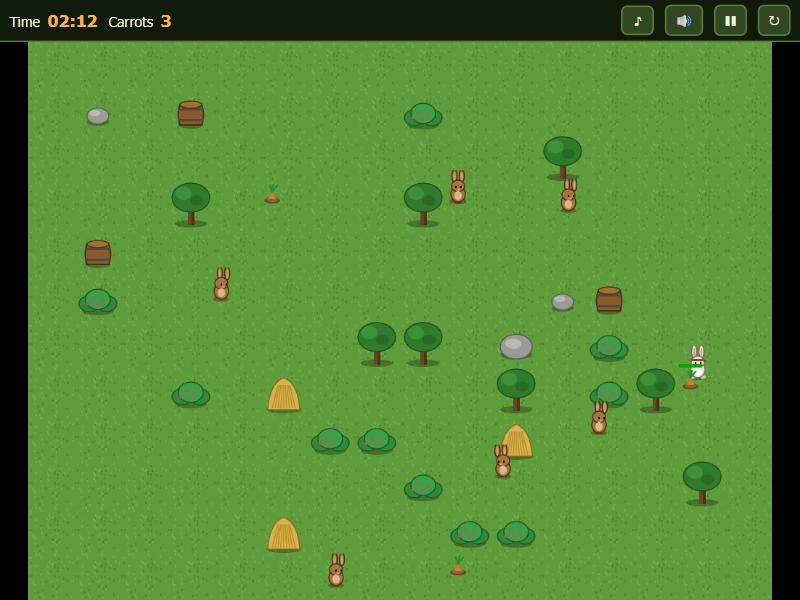

# Raging Gardens

**[▶ Play here](https://linkingtechnologies.github.io/libre-arcade/raging-gardens/public/index.html)**



A restoration of **Raging Gardens** (Petar Petrov, GitHub Game Off 2012, honorable mention), an HTML5 game
in which a hungry ninja rabbit pulls carrots for three minutes while a growing horde of rival rabbits goes
for the same carrots. You can push rivals away (Q, which costs a carrot and, as the original puts it, is
done with a fart) or plant a Carrot-on-a-Fork totem that draws them off (W, two carrots).

The original ran on CraftyJS, jQuery, Backbone, RequireJS and online leaderboards. This version is plain
HTML5 canvas and vanilla JavaScript, no library, no server and no network request apart from the
collection's analytics beacon, and it is checked against the original game frame by frame:

- **The game logic is a port, verified against the original running.** `public/src/sim.js` ports the
  original's tilemap, player, enemy and game loop. The untouched original (Crafty 0.6.3 and the author's
  sources) is run in a browser under a seeded random generator and a virtual clock, its complete state is
  recorded after every one of the 9000 frames of a game, and the port, given the same seed and the same
  key presses, must reproduce it exactly. 19 recorded games (171,000 frames) agree; see
  [`specs/port-map.md`](specs/port-map.md) for what that does and does not cover.
- **The original artwork is not used.** It is "(c) Stremena Tuzsuzova", all rights reserved, and the
  original README itself says the MIT licence covers the game *without* its art. The pictures here are
  new, drawn by `src/art.js`; the sound effects are synthesised; the music is the original's CC0 track,
  in full quality. Nothing is shipped that the publication gate (`npm run gate`) cannot account for.

[`SOFTWARE_ARCHAEOLOGY.md`](SOFTWARE_ARCHAEOLOGY.md) tells how this was recovered,
[`PROVENANCE.md`](PROVENANCE.md) lists what came from where, and [`docs/`](docs/) holds the audits.

## Controls

| Key | Action |
|---|---|
| Arrow keys | Move |
| Z (or Y), hold | Pull the carrot you stand on |
| Q | Eat 1 carrot, push nearby rivals away (acts when released, as in the original) |
| W | Eat 2 carrots, plant a totem that attracts rivals (one at a time) |
| P or Esc | Pause |

On a touch screen there is a d-pad and three buttons. The game speaks English and Italian (browser
language detected, switchable on the menu).

## Running it

```powershell
npm install
npm run dev        # serves public/ at http://localhost:8080
npm run start      # builds game/ and serves it
npm run check      # lint, tests, publication gate
npm run package    # release/raging-gardens-<version>.zip (refuses to run if the gate fails)
```

`public/` is the game itself and runs from any static web server (GitHub Pages included). `?seed=N`
on the URL plays a reproducible game, which is how the tests drive it.

Further commands, none of them needed to play:

```powershell
node scripts/fetch-original.mjs     # fetch the full original trees into reference/.fetched and verify their hashes
node tools/oracle/run.mjs [name]    # re-record the original in headless Edge/Chrome (tools/oracle/out/)
node tools/oracle/diff.mjs greedy-1 # first differing frame between a recording and the port
node tools/oracle/make-golden.mjs   # refresh tests/golden/ from the recordings
node tools/e2e/run.mjs [public|game] # real-browser smoke test
node scripts/update-provenance.mjs  # refresh the shipped-file inventory after a reviewed change
```

Part of [Libre Arcade](https://github.com/linkingtechnologies/libre-arcade), a collection of restored and ported games.

## License

New code in this folder is GPL-3.0-or-later (see [`LICENSE`](LICENSE)). The game logic and path-finding are
ports of MIT-licensed code (Petar Petrov; Brian Grinstead, with a heap by Marijn Haverbeke under CC BY 3.0),
and the music is CC0: the notices are in [`THIRD_PARTY_NOTICES.md`](THIRD_PARTY_NOTICES.md). The original
artwork and sound effects are not covered by any of this and are not included.
